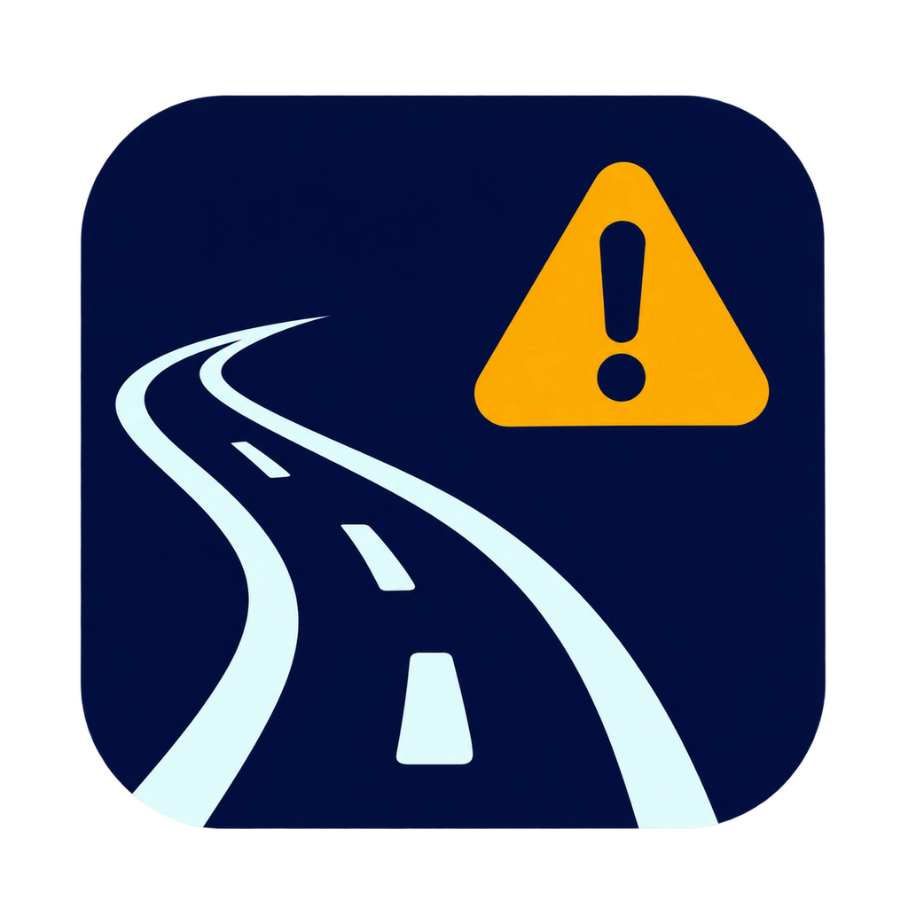

# Vegvarsel



Vegvarsel is a Home Assistant integration that warns you about road problems on your own routes in Norway. It reads the official traffic messages from Statens vegvesen: closures, accidents, convoy driving, roadworks, rockfall and the like.

It knows when you drive. You tell it your days and times, and it tells you:

- **the evening before**, about planned closures that affect tomorrow's trips
- **when you're about to leave**, with a summary of what lies over the trip
- **while you're driving**, the moment something new turns up, gets worse or clears

It stays quiet about everything else: a night closure of the tunnel that's over by 06:00 doesn't spoil your 07:00 commute, and roadworks on a parallel road 300 m away don't count.

> **Status: early, in daily use.** Tested against Statens vegvesen's live DATEX II 3.1 feed, their published national sample, and hand-written cases.

## What you need

1. **A free DATEX account from Statens vegvesen.** Request access here: <https://www.vegvesen.no/en/fag/technology/open-data/a-selection-of-open-data/what-is-datex/get-access/>. You'll get a username and password. Keep them to yourself: Statens vegvesen's terms say DATEX credentials are confidential.
2. Home Assistant 2025.4 or newer.

## Install

With HACS: *HACS → ⋮ → Custom repositories*, add `https://github.com/maxakassiouk/vegvarsel` as an *Integration*, install **Vegvarsel**, then restart Home Assistant. The repository must be public for HACS to access it.

Manually: copy `custom_components/vegvarsel` into your `config/custom_components/` folder and restart Home Assistant.

### Moving from a manual installation

Install through HACS as above, then restart Home Assistant. Keep the existing
Vegvarsel entry under *Settings → Devices & services*: there is no need to remove
it or add your account and routes again. HACS replaces the integration files in
`custom_components/vegvarsel`; the existing Home Assistant configuration stays in place.

HACS checks for new versions and provides an update entity. When an update is
available, install it from *Settings → Updates*, then restart Home Assistant.
Checking for updates is automatic; installing them still requires your action
unless you separately configure an update automation.

### Publishing updates (maintainer)

1. Update `version` in `custom_components/vegvarsel/manifest.json` and
   `pyproject.toml`, and `VERSION` in `custom_components/vegvarsel/const.py`
   together, for example to `0.2.2`.
2. Commit and push the changes. Wait for the **Validate** workflow to pass.
3. On [GitHub Releases](https://github.com/maxakassiouk/vegvarsel/releases),
   choose **Draft a new release**, create a matching tag (for example `v0.2.2`),
   and select the branch containing those changes. The current default branch is
   `main`.
4. Add release notes and publish a normal release. A draft or a tag by itself is
   not a published release. The initial release in this repository is `v0.2.1`.

HACS downloads the files under `custom_components/vegvarsel` directly from the
release tag; this repository does not require an attached ZIP file. It does not
need to be included in HACS's default catalog to work as a custom repository.

## Set up

1. *Settings → Devices & services → Add integration → Vegvarsel*, then enter your DATEX username and password.
2. On the Vegvarsel entry, click **Add route**:
   - **Name**, for example "Til jobb".
   - **Start** and **destination**: a zone (such as *Home*) or a point on the map.
   - **Via points** (optional): the route is calculated as the fastest drive. If you take a different road, add a point on it. The review step links to the same route on OpenStreetMap so you can check it.
   - **Corridor**: how far from the route a message can be and still count. The default is 150 m.
   - **Days**, **watch windows** (for example `06:30-08:00` and `15:30-17:00`) and an **evening preview** time (for example `21:00`). Start each window when you'd want to know *before leaving*. Leave the windows empty to watch around the clock.
3. Create an automation from the **Vegvarsel - Route alerts** blueprint (it's installed automatically). Pick your phone and you're done.

Add as many routes as you like. They all share one download of the feed.

## The dashboard card

Vegvarsel brings its own dashboard card; there's nothing to install separately. Edit a dashboard, **Add card**, and pick **Vegvarsel** (or add `type: custom:vegvarsel-card` in YAML).

It shows:

- **the route** on Home Assistant's map, with its start (A), stops and destination (B)
- **the traffic messages on it** as markers, and a list in driving order ("Roadworks · Rv658 · 1.4 km")
- **a status line**: whether your next trip has a problem, which window is being watched, and the next closure
- a **Google Maps** button that opens the route there

Administrators also get **Edit route** and **+ New route**, which open a route planner in the card:

1. **From**, **To** and any **stops** between. Type an address or place (suggestions from Kartverket as you type), or pick a zone, a person or the centre of the map. Swap the ends with ⇅.
2. **Calculate** draws the route and the traffic messages on it for the next two weeks. Between two places you also get OSRM's alternative routes; click one to choose it.
3. Set the name, days, watch windows, evening preview and corridor, then **Save**. Editing keeps it the same route, so automations pointing at it keep working.

Card options (all in the visual editor): `route_id` (which route; default the first), `title`, `map_height` (px, default 320), `show_list`, `show_google`, `landscape` (map beside the list on wide cards).

The card is drawn on Home Assistant's own map component. That component has no public interface for drawing, so a future Home Assistant could stop the line and markers from showing; the status and the list keep working.

## Try it before you have DATEX access

`tools/demo_feed.py` is a small stand-in for the feed that you run on any computer with Python 3.11 or newer. It serves Statens vegvesen's own published sample of the national feed with its dates moved to this week, plus made-up situations around Ålesund that you switch on and off from a web page:

- an accident in Ellingsøytunnelen
- convoy driving towards Vigra
- night closures of the tunnel
- roadworks on a parallel road, which should *not* alert

```bash
python tools/demo_feed.py
```

The first run downloads the sample (~30 MB). Use `--small` for a tiny one. On Windows, allow Python through the firewall on private networks when asked.

1. Open the control page it prints (`http://localhost:8765/`). It shows the **feed address** to use, e.g. `http://192.168.1.20:8765/datexapi/GetSituation/pullsnapshotdata`.
2. In Home Assistant, add Vegvarsel with any username and password. Open **Advanced** at the bottom of the form and paste the feed address.
3. Add a route (for example *Home* → work, through Ellingsøytunnelen) and create an automation from the blueprint.
4. Optionally set the check interval to 1 minute under the integration's options.
5. Switch scenarios on and off on the control page. Within a check or two, the problem sensor changes, a marker appears on the map, and your phone gets the alert.

When your real access arrives, delete the demo entry and add Vegvarsel again with your DATEX login.

## What you get, per route

| Entity | What it shows |
|---|---|
| `binary_sensor.<route>_problem_on_route` | On while something lies over your current or next trip. Attributes include the worst incident and the time span being watched. |
| `sensor.<route>_incidents` | How many incidents affect that trip, with their details in the `incidents` attribute. |
| `sensor.<route>_next_closure` | When the next closure or convoy on the route begins (or began, if it's going on now). |
| `geo_location.*` | One map marker per incident, sourced `vegvarsel_<route>`. The state is the distance along the route in km. |

### Events, for your own automations

| Event | When |
|---|---|
| `vegvarsel_incident_new` | Something new on the route, inside a watch window |
| `vegvarsel_incident_updated` | It got worse, for example from roadworks to road closed |
| `vegvarsel_incident_cleared` | It's gone |
| `vegvarsel_digest` | `reason: window_start` when a window opens; `reason: evening_preview` the evening before |

An incident's data includes `route`, `device_id`, `kind` (`closed`, `accident`, `convoy`, `obstruction`, `traffic`, `restriction`, `roadworks`, `conditions`, `info`), `kind_name`, `summary`, `road`, `description`, `distance_km`, `start`, `end`, `applies_now`, `latitude` and `longitude`. A digest has `count` and `incidents` (a list of those).

Nothing is fired for incidents that were already there when Home Assistant started. Those show up in the next window-start summary instead, so a restart doesn't repeat alerts.

## How it works

- The integration checks the DATEX II situation feed every 2 minutes; you can change this under the integration's options. It also checks at the exact minute each window opens and at preview time. It only downloads the feed again when it has changed.
- Each route's line is calculated once, when you set it up, using the public [OSRM](https://project-osrm.org) server (OpenStreetMap data). Your position is never sent anywhere after that.
- A message counts if any point of its location, including the stretch between its end points, is within the corridor. It also has to apply during the trip being watched. Recurring validity such as "every night 22:00–06:00, Monday to Thursday" is handled.

## Development

Python 3.13 or newer:

```bash
pip install -r requirements_test.txt
pytest
```

On Windows, Home Assistant's test plugin needs two Unix-only modules. Small stand-ins are in `tools/winstubs`:

```bash
PYTHONPATH=tools/winstubs pytest
```

`tests/fixtures/npra_sample_excerpt.xml` is an excerpt of [Statens vegvesen's official sample](https://git.vegvesen.no/projects/DATEX2/repos/datex2-spesifications/browse/3.1/samples/roadTrafficInformation) (NLOD). `tests/fixtures/situations_synthetic.xml` is **hand-written** sample data around Ålesund. To record the live feed, save it as `tests/fixtures/live_*.xml`. Those files are git-ignored because they're large and fetched with your own credentials.

## Related

[vegvesen_datex](https://github.com/vfurnes/vegvesen_datex) reads the same DATEX feed. It covers weather stations, travel times, and incidents within a radius of a zone. Vegvarsel is different in three ways: it follows a route rather than a circle, it knows *when* you drive, and it sends alerts.

## Credits

Traffic data © Statens vegvesen, under the [Norwegian Licence for Open Government Data (NLOD)](https://data.norge.no/nlod/en/2.0). Routes from OSRM, map data © OpenStreetMap contributors. Design ideas borrowed from the excellent [TomTom integration](https://github.com/somansch/tomtom).
